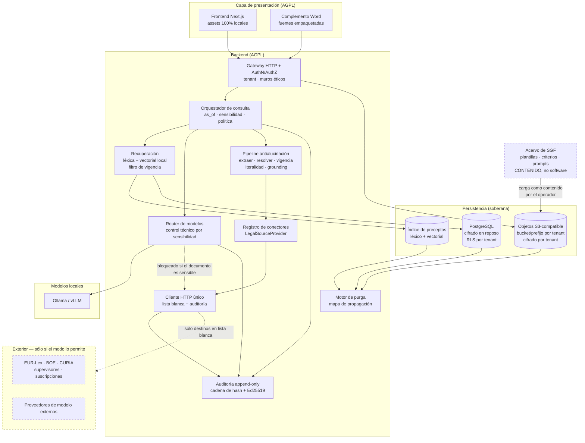

# 02 — Arquitectura objetivo

**Estado:** borrador para aprobación (Fase 0).
**Fecha:** 2026-09-08.
**Documentos previos:** `00-licencia-agpl.md`, `01-inventario-us-centrico.md`.
**Decisiones formalizadas:** `docs/adr/` (ADR-0001 a ADR-0012).

---

## 0. Principios rectores

Por orden de prelación, tal y como los fija el encargo. Ante conflicto entre dos
principios, gana el de número menor **siempre**, aunque el resultado sea peor
técnicamente:

1. **Confidencialidad y soberanía del dato.**
2. **Exactitud verificable** de toda referencia normativa y jurisprudencial.
3. **Utilidad operativa.**
4. Velocidad de desarrollo.

Corolarios que se aplican sin excepción en todo el diseño:

- **Fallo cerrado.** Ante duda, el sistema deniega, no degrada. Un destino de red
  no autorizado falla; no se intenta por otra vía. Una cita no resuelta no se
  presenta como verificada. Un documento sensible no se envía a un modelo
  externo, aunque el local esté caído.
- **Cero por defecto.** Todo lo que implique salida de datos está desactivado de
  fábrica y requiere activación explícita, registrada en auditoría.
- **Sin verdad implícita.** Ninguna afirmación jurídica sin fragmento recuperado
  que la sostenga. Ninguna consulta sin fecha de referencia declarada.

---

## 1. Vista general



Lo esencial del diagrama: **toda salida de red pasa por `EGR`**, y `EGR` es el
único punto del sistema autorizado a abrir una conexión saliente. No hay atajos.
El acervo de SGF (plantillas, criterios de revisión, playbooks, prompts de valor)
**no es parte del programa**: entra como contenido cargado por el operador, por
las mismas rutas que un documento de cliente. El árbol AGPL contiene la
capacidad, vacía de contenido (`00-licencia-agpl.md`, §3; ADR-0001).

---

## 2. Modos de despliegue y soberanía (Requisito 1)

Un único parámetro gobierna el comportamiento: `SOVEREIGNTY_MODE`.

| | `local-only` | `nube-propietaria` | `hibrido` |
| --- | --- | --- | --- |
| Salida de red a terceros | **Ninguna** | Sólo a destinos de la lista blanca | Sólo a destinos de la lista blanca |
| Modelos | Sólo local (Ollama/vLLM) | Local o externos autorizados | Local o externos autorizados |
| Fuentes jurídicas | Corpus local ingerido fuera de línea | Conectores en vivo + corpus local | Conectores en vivo + corpus local |
| Almacenamiento | Disco local / MinIO | S3-compatible autoalojado o con residencia UE **verificada al arranque** | Local |
| Verificación | Prueba de integración en red Docker sin Internet | Comprobación de residencia y de cifrado al arranque | Prueba de lista blanca |

### 2.1 Cliente HTTP único y lista blanca (ADR-0002)

- Módulo `backend/src/lib/net/egress.ts`. **Es el único lugar del programa donde
  se llama a `fetch`.**
- Aplicación forzosa en tres capas, porque una sola es una recomendación:
  1. **Estática:** regla ESLint `no-restricted-globals` sobre `fetch` y
     `no-restricted-imports` sobre `axios`, `undici`, `node:http(s)`, con
     excepción única para `egress.ts`.
  2. **Gate de CI:** falla el pipeline si aparece `fetch(` fuera del módulo.
  3. **Runtime:** en el arranque se sustituye `globalThis.fetch` por una función
     que lanza excepción, salvo la referencia capturada por `egress.ts`.
- Toda llamada saliente registra en auditoría: tenant, destino, conector,
  propósito, `as_of`, resultado y bytes. **Un destino no listado lanza error; no
  hay degradación silenciosa.**
- Se reutiliza y amplía `backend/src/lib/privateIp.ts` (ya presente en la base)
  para la defensa contra SSRF, y se añade **resolución previa de DNS con
  comprobación de la IP resuelta** (defensa frente a *DNS rebinding*).
- `SOVEREIGNTY_MODE=local-only` vacía la lista blanca de forma irreversible en
  tiempo de ejecución: la configuración no puede reintroducir destinos sin
  reiniciar el proceso con otro modo.

### 2.2 Prueba de red aislada (criterio de aceptación)

Suite `backend/src/__tests__/airgap/`, ejecutada en CI sobre una red Docker
declarada `internal: true` (sin gateway a Internet). Verifica que operan:

- ingesta de documentos, extracción y conversión;
- indexación de preceptos y recuperación con `as_of`;
- chat con modelo local;
- revisión tabular y flujo de trabajo;
- exportación con manifiesto firmado;
- y que **cualquier intento de salida a un destino externo produce error
  explícito y queda registrado**, en vez de un tiempo de espera silencioso.

Requisito previo: resolver los hallazgos S-01 a S-05 del inventario (fuentes
remotas de Google, CDN de PDF.js, sincronización de *workflows* desde GitHub).
Sin eso, la aplicación no arranca en red aislada.

### 2.3 Cifrado en reposo (ADR-0003)

- **Base de datos:** cifrado a nivel de volumen o de instancia gestionado por el
  operador (LUKS / cifrado del proveedor), más cifrado a nivel de aplicación de
  las columnas con contenido sustantivo mediante sobre de claves.
- **Objetos:** cifrado del lado del cliente, antes de subir, con clave de datos
  por tenant (envelope encryption). El almacén nunca ve texto en claro. Esto
  permite además el *crypto-shredding* del apartado 9.
- **Claves:** jerarquía KEK (clave maestra del operador, en HSM, KMS soberano o
  fichero protegido según despliegue) → DEK por tenant → DEK por objeto. **Ninguna
  clave embebida en el código ni en la imagen.**
- `.env.example` con *placeholders* no funcionales y una comprobación de arranque
  que aborta si detecta un valor de ejemplo en producción.

### 2.4 Multi-tenancy (ADR-0004)

- `tenant_id` obligatorio en toda tabla con contenido de negocio, con RLS que lo
  filtra por el claim de sesión. Sin excepciones: una tabla sin `tenant_id` es un
  fallo de revisión.
- Aislamiento de objetos por **bucket o prefijo dedicado por tenant**, con
  credenciales distintas por tenant donde el almacén lo soporte.
- `kill switch` por tenant: interruptor que deshabilita de inmediato **todos** los
  proveedores externos de modelo para ese tenant. Efecto inmediato sobre
  peticiones en curso, registrado en auditoría, reversible sólo por el operador.

---

## 3. Modelo de fuentes: jerarquía y tipología (Requisito 2.1)

No es una lista plana de documentos. Entidades de primer nivel:

```
Instrumento (norma)
 ├── identificador canónico: ELI
 ├── nivel: supranacional | nacional | autonómico | local
 ├── tipo: tratado | reglamento_ue | directiva | decision | reglamento_delegado |
 │         reglamento_ejecucion | soft_law_ue |
 │         constitucion | ley_organica | ley_ordinaria | real_decreto_ley |
 │         real_decreto_legislativo | real_decreto | orden_ministerial |
 │         circular_supervisor | ...
 ├── rango: entero derivado del tipo y del nivel (para el conflicto jerárquico)
 ├── autoridad emisora, diario oficial, fecha de firma, fecha de publicación
 └── Estructura (árbol)
      libro → título → capítulo → sección → artículo → apartado → letra → ordinal
        └── Precepto  ← UNIDAD DE INDEXACIÓN Y DE CITACIÓN
             └── Redacción (1..N, versionado temporal)
                  └── Manifestación lingüística (1..N, todas auténticas en la UE)
```

Y, junto a ellas:

- **Disposiciones** (transitorias, adicionales, derogatorias, finales) como
  **entidades propias**, no como texto suelto al final del documento. Llevan su
  propia numeración ordinal, su propio texto y sus propias relaciones "afecta a".
  Son determinantes para el régimen aplicable y son sistemáticamente ignoradas
  por los sistemas de IA jurídica; aquí son ciudadanas de primera clase
  (ADR-0006).
- **Relaciones normativas** tipadas: `modifica`, `deroga`, `suspende`, `anula`,
  `transpone`, `desarrolla`, `ejecuta`, `prorroga`, `aplaza`, `corrige`. Con
  ámbito (total / parcial) y, cuando se conozca, a nivel de **precepto**, no sólo
  de instrumento. La relación de **transposición** es bidireccional y navegable:
  de Directiva a normas nacionales de transposición y viceversa.
- **Resoluciones judiciales** como **fuente interpretativa**, nunca primaria
  vinculante (ADR-0007). Atributos:
  - `valor_interpretativo`: `doctrina_consolidada` | `sentencia_aislada` |
    `supranacional_tjue` | `supranacional_tedh` | `constitucional`;
  - `organo`, `sala`, `numero/año`, `fecha`, `ponente`, `firmeza`, `ECLI`;
  - citas salientes a preceptos (con la redacción concreta aplicada).
  **No se importa lógica de *stare decisis*.** No hay campos `binding`,
  `overruled`, `distinguished` ni jerarquía de vinculación entre tribunales.
- **Soft law** (directrices EBA/ESMA/EIOPA, dictámenes EDPB, circulares de
  supervisores) como fuente interpretativa administrativa, con autoridad emisora
  y declaración expresa de su carácter no vinculante.

**Conflicto de normas.** El modelo almacena lo necesario para que el sistema
pueda **detectar y declarar** conflictos por jerarquía (rango), competencia
(nivel territorial y materia), temporalidad (fechas de vigencia) y especialidad
(ámbito material). El sistema **detecta y expone** el conflicto; **no lo
resuelve** por su cuenta: lo declara y presenta los criterios. Resolverlo es
trabajo del abogado.

---

## 4. Granularidad y temporalidad: el núcleo (Requisito 2.2)

### 4.1 Bitemporalidad (ADR-0005)

Cada redacción de un precepto lleva **dos ejes temporales**:

| Eje | Campos | Para qué |
| --- | --- | --- |
| **Vigencia** (tiempo del mundo) | `fecha_inicio_vigencia`, `fecha_fin_vigencia`, `estado` | Responder "¿qué decía el artículo el 3 de mayo de 2021?" |
| **Conocimiento** (tiempo del sistema) | `ingerido_en`, `sustituido_en`, `fuente`, `hash` | Responder "¿qué sabía el sistema cuando emitió aquella respuesta?" — indispensable para auditoría y para defender una respuesta pasada |

`estado` ∈ { `vigente`, `derogado`, `suspendido`, `anulado`, `no_vigente_aun` }.
Cada redacción apunta a la **norma modificativa** que la introdujo.

Además se modelan explícitamente, porque son habituales en Derecho de la UE y
rompen los modelos ingenuos:

- **Aplicación diferida**: la norma está en vigor pero no es aplicable hasta una
  fecha posterior (campos `fecha_aplicabilidad` distinta de `fecha_vigencia`).
  Caso real verificado: Reglamento (UE) 2024/1689, art. 113 — entrada en vigor a
  los veinte días de su publicación, aplicación general desde el 2 de agosto de
  2026, con calendarios escalonados distintos por capítulos (2 de febrero de 2025,
  2 de agosto de 2025, 27 de julio de 2026, 2 de diciembre de 2027, 2 de agosto
  de 2028). **Un modelo con un solo campo de fecha no puede representar esta
  norma.**
- **Prórrogas** como relación normativa que desplaza `fecha_fin_vigencia` o
  `fecha_aplicabilidad`, conservando la redacción anterior y su procedencia.

### 4.2 Fecha de referencia obligatoria (`as_of`) (ADR-0005)

- Toda consulta lleva `as_of`. Por defecto, hoy; modificable por el usuario en la
  interfaz de forma visible y persistente durante la sesión de trabajo.
- **Se implementa como tipo, no como convención:** las funciones de recuperación
  reciben un `AsOfDate` (tipo *branded*); no existe sobrecarga sin él. Un
  desarrollador no puede "olvidarse" de pasarlo.
- La recuperación filtra por vigencia a esa fecha. Una consulta sobre un contrato
  de 2021 recupera la redacción de 2021.
- La fecha de referencia empleada **se declara en cada respuesta** y se registra
  en auditoría junto con las redacciones concretas (por `hash`) que se aportaron
  al contexto.
- Si el corpus no cubre la fecha solicitada (p. ej., no se dispone de la redacción
  de 2015 de un precepto), el sistema **declara la laguna**. No interpola, no
  ofrece la redacción vigente como sucedáneo, no avisa en letra pequeña.

### 4.3 Recuperación (ADR-0008)

Recuperación híbrida a nivel de precepto:

1. **Filtro duro previo** por `as_of`, jurisdicción, nivel y materia. El filtro
   temporal es lo primero, no un reordenamiento posterior. Un precepto no vigente
   a `as_of` no entra en el conjunto candidato salvo petición expresa de consulta
   histórica.
2. **Léxica**: PostgreSQL FTS con configuración española, más `pg_trgm` (ya
   presente en la base) para tolerancia a variantes y abreviaturas.
3. **Vectorial**: opcional y **siempre con embeddings calculados por un modelo
   local**. En `local-only` no cabe otra cosa; en los demás modos se mantiene la
   misma regla por coherencia (enviar el corpus a un proveedor externo para
   vectorizarlo sería una fuga de datos difícil de justificar).
4. **Expansión estructural**: recuperado un apartado, se aportan al contexto su
   artículo, sus letras y las **disposiciones** que le afectan. Un apartado leído
   fuera de su artículo se malinterpreta.

---

## 5. Identificadores, formatos y multilingüismo (Requisito 2.3)

| Elemento | Decisión | Estado de verificación |
| --- | --- | --- |
| Identificador canónico de norma | **ELI** (European Legislation Identifier) | Adoptado. `[PENDIENTE DE VERIFICACIÓN: referencia exacta de las Conclusiones del Consejo en el DOUE serie C que establecen el ELI, antes de citarlas en documentación o en la interfaz]` |
| Identificador canónico de resolución judicial | **ECLI** (European Case Law Identifier) | Adoptado. `[PENDIENTE DE VERIFICACIÓN: referencia exacta de las Conclusiones del Consejo en el DOUE serie C que establecen el ECLI]` |
| Formato de intercambio | **Akoma Ntoso** | `[PENDIENTE DE VERIFICACIÓN: versión de la especificación OASIS a la que nos ajustamos]` |
| Formato nativo EUR-Lex | **Formex** | `[PENDIENTE DE VERIFICACIÓN: versión vigente del esquema y su documentación oficial]` |
| Formato nativo BOE | **XML del BOE** (legislación consolidada y sumarios) | `[PENDIENTE DE VERIFICACIÓN: esquema y condiciones de uso del servicio de datos abiertos del BOE]` |

Regla: **ELI y ECLI son los identificadores internos**. Los identificadores
nativos de cada proveedor (CELEX, BOE-A-AAAA-NNNNN, ROJ, número de asunto) se
almacenan como alias resolubles, no como clave.

**Multilingüismo.** El precepto es una entidad con **N manifestaciones
lingüísticas enlazadas**, todas marcadas como auténticas cuando lo son (caso de
las normas de la UE). Consecuencias de diseño:

- La comparación entre versiones lingüísticas es **una herramienta de trabajo del
  producto**, alineada precepto a precepto, no un extra: es un método
  interpretativo real cuando el texto español de una norma UE resulta ambiguo.
- El índice de recuperación es por manifestación, con retorno al precepto.
- El pipeline de literalidad compara contra la manifestación en el idioma en el
  que se cita.

---

## 6. Citación y estilo (Requisito 2.4)

### 6.1 Formateador

Ficheros de estilo declarativos en `config/estilos-cita/*.toml`, uno por
jurisdicción y tradición. **Nada cableado en el código.** Un fichero de estilo
declara abreviaturas, orden de los elementos, separadores, y plantillas por tipo
de fuente. Ejemplos objetivo:

- `art. 1255 CC`
- `art. 28.3 RGPD`
- `art. 50.4 del Reglamento (UE) 2024/1689`
- `STS 123/2024, de 5 de marzo (ECLI:ES:TS:2024:123)`
- `STJUE de 16 de julio de 2020, asunto C-311/18 (ECLI:EU:C:2020:559)` *(ejemplo
  de plantilla; los valores concretos se rellenan con datos resueltos, nunca de
  memoria)*

### 6.2 Parser

Reconocimiento de citas en el texto de entrada mediante **gramática** (PEG), no
mediante acumulación de expresiones regulares. Debe cubrir:

- Citas completas y abreviadas, con las abreviaturas habituales del foro español
  (`CC`, `CP`, `LEC`, `LECrim`, `LJCA`, `ET`, `LGT`, `TRLGDCU`, `LOPJ`…) y de la
  UE (`RGPD`, `TFUE`, `TUE`, `CDFUE`…).
- Referencias jerárquicas parciales: `art. 5.2 b)`, `apartado segundo`,
  `disposición transitoria tercera`.
- **Remisiones internas anafóricas**: "el artículo anterior", "el apartado 2 del
  artículo 5", "los preceptos precedentes", "esta ley". Su resolución exige
  conocer la **posición estructural** del texto que se está leyendo, y por eso
  depende del árbol del apartado 3: sin estructura no hay anáfora resoluble.
- Citas en las demás lenguas oficiales de la UE cuando el documento las contenga.

Cobertura mínima exigida antes de dar el parser por terminado: **95 % de aciertos
sobre un corpus etiquetado de escritos reales anonimizados** `[PENDIENTE: SGF
debe facilitar o autorizar la construcción de ese corpus; no puede vivir en el
árbol AGPL]`.

---

## 7. Conectores a bases de datos jurídicas (Requisito 3)

### 7.1 Interfaz

`LegalSourceProvider`, tal y como se define en el encargo, con estas precisiones:

- `authenticate(credentials)` recibe **siempre** credenciales del tenant. El
  sistema **no incluye ni distribuye** claves de ningún proveedor.
- `search(query, filters, asOfDate)`: `asOfDate` es obligatorio.
- `fetchDocument(identifier)`: ELI, ECLI o identificador nativo.
- `resolveCitation(citation)` → identificador canónico + texto. Es la pieza que
  usa el pipeline antialucinación.
- `healthCheck()`: sin efectos, sin credenciales, sujeto a lista blanca.

### 7.2 Manifiesto obligatorio de cada conector

```toml
[conector]
id = "..."
nombre_visible = "..."
jurisdicciones = ["ES", "EU"]
tipos_fuente = ["legislacion", "jurisprudencia", "soft_law"]
nivel_licencia = "abierto" | "suscripcion"

[capacidades]
search = true
fetchFullText = true
temporalVersions = false
consolidatedText = true
citationResolve = true
alerts = false

[condiciones_uso]
url = "https://..."                    # obligatorio
regimen_reutilizacion = "..."          # obligatorio
permite_almacenamiento_local = false   # obligatorio
permite_indexacion = false             # obligatorio
permite_ingesta_en_sistema_ia = false  # obligatorio
verificado_en = "AAAA-MM-DD"
```

### 7.3 Reglas duras de la capa

1. **Sólo canales autorizados.** Únicamente API documentada, servicios de datos
   abiertos, descarga masiva autorizada u OAI-PMH.
   **Queda prohibido implementar *scraping*, elusión de límites de tasa, rotación
   de *user agents* o cualquier técnica de acceso no autorizado, aunque sea
   trivial y aunque se solicite expresamente más adelante.** Esta regla se
   traslada literalmente a `CLAUDE.md` y `AGENTS.md` del fork.
   Si un proveedor no ofrece vía autorizada, el conector se declara
   `unavailable: no authorized access channel` y se documenta como tal.
2. **Puerta de términos de uso.** El arranque de un conector exige confirmación
   explícita del operador de que ha revisado las condiciones declaradas en el
   manifiesto. Sin esa confirmación, el conector no arranca. La confirmación —con
   operador, fecha, versión del manifiesto y hash de las condiciones— se registra
   en el log de auditoría.
3. **Modo `reference-only`, implementado y probado.** Si el proveedor no autoriza
   el almacenamiento local del texto íntegro, el conector:
   - cachea únicamente metadatos e identificadores;
   - recupera el texto en tiempo de consulta;
   - **no lo persiste** en el índice ni en el almacén de objetos;
   - lo mantiene en memoria sólo durante el turno, con TTL.
   La prueba de aceptación inspecciona el índice y el almacén tras una consulta y
   falla si aparece texto íntegro del proveedor restringido. No es una nota de
   documentación: es un test.
4. **Credenciales cifradas** con clave del operador, por tenant, reutilizando el
   mecanismo AES-GCM ya existente (`user_api_keys`), con interfaz de gestión en
   la UI.

### 7.4 Orden de implementación

**Fase A — fuentes abiertas.** EUR-Lex, DOUE, CURIA, BOE (datos abiertos y
legislación consolidada), boletines autonómicos, portales de supervisores (CNMV,
Banco de España, AEPD, CNMC, EBA, ESMA).

> Marco de reutilización, verificado en fuente oficial en lo que sigue:
> - **Reutilización de información del sector público en España**: Ley 37/2007,
>   de 16 de noviembre (BOE-A-2007-19814), con la redacción vigente dada por el
>   RD-ley 24/2021; su art. 2 delimita el ámbito subjetivo (AGE, CC. AA.,
>   Administración Local, sector público institucional y determinadas sociedades
>   mercantiles públicas) y su art. 3 el objetivo, con exclusiones relevantes
>   —entre otras, documentos sometidos por norma a deber de reserva, secreto o
>   confidencialidad, y documentos sobre los que existan derechos de propiedad
>   intelectual de terceros—. Desarrollo estatal: RD 1495/2011 (BOE-A-2011-17560).
>   Marco UE refundido: Directiva (UE) 2019/1024 (CELEX 32019L1024). **Verificado.**
> - **Reutilización de documentos de la Comisión Europea**: Decisión 2011/833/UE
>   (CELEX 32011D0833); su art. 2 delimita el ámbito y sus exclusiones.
>   **Verificado.**
> - **Condiciones concretas de cada portal** (aviso legal del BOE, aviso legal de
>   EUR-Lex, condiciones de CURIA, avisos de cada supervisor):
>   `[PENDIENTE DE VERIFICACIÓN — el entorno de trabajo tenía bloqueado el acceso
>   a esos dominios. Ningún conector de Fase A se implementa antes de leer y
>   registrar su aviso legal en el manifiesto.]`

**Fase B — fuentes de suscripción.** vLex, Tirant, Aranzadi/La Ley y equivalentes.
**Condicionadas a la existencia de API oficial y a licencia contratada por el
usuario.** Se implementa primero el esqueleto y la interfaz. **No se simula la
integración ni se inventan *endpoints*.** Si no se dispone de documentación
verificable de la API de un proveedor, el trabajo se detiene y se solicita a SGF.
Estado actual: **sin documentación verificable de ninguno de los cuatro**.

**Fase C — jurisprudencia nacional.**

> **Advertencia sobre CENDOJ.** Lo verificado en fuente oficial:
> - El CGPJ tiene atribuida la potestad reglamentaria en materia de *"Publicación
>   y reutilización de las resoluciones judiciales"* (art. 560.1.16ª.e LOPJ), así
>   como el cuidado de la publicación oficial de sentencias y la regulación del
>   Centro de Documentación Judicial (art. 560.1.10ª y 12ª LOPJ). **Verificado.**
> - El Reglamento 1/2005 del CGPJ, de aspectos accesorios de las actuaciones
>   judiciales (BOE-A-2005-15939), regula en su art. 7 la remisión de todas las
>   sentencias al CGPJ a través del Centro de Documentación Judicial. **Verificado.**
> - **El CGPJ no figura en el ámbito subjetivo del art. 2 de la Ley 37/2007**, de
>   modo que el régimen general de reutilización del sector público **no es el
>   aplicable** a las resoluciones judiciales: lo es la regulación propia del
>   CGPJ. **Verificado.**
> - Existencia de una API pública abierta equiparable a las de Fase A y
>   condiciones concretas de reutilización del CENDOJ:
>   `[PENDIENTE DE VERIFICACIÓN]`. Según la información disponible, el CENDOJ no
>   ofrece una API pública abierta equiparable y sus condiciones de reutilización
>   son restrictivas.
>
> **Decisión:** el conector CENDOJ queda como ***stub* documentado**. No se
> implementa acceso por vías no autorizadas. Requiere verificación directa y, en
> su caso, **consulta formal al CENDOJ**, y confirmación expresa de SGF del canal
> habilitado antes de escribir una sola línea de integración.
>
> Alternativa mientras tanto: jurisprudencia del TJUE y del Tribunal General vía
> CURIA/EUR-Lex, y jurisprudencia constitucional por el canal que corresponda
> `[PENDIENTE DE VERIFICACIÓN de sus respectivas condiciones]`.

### 7.5 Consecuencia para `local-only`

En `local-only` no hay conectores en vivo. La única forma de tener fuentes es un
**corpus local**, ingerido fuera de línea desde descarga masiva autorizada y
refrescado por un procedimiento explícito del operador. El sistema debe:

- declarar en la interfaz la **fecha de última actualización del corpus**;
- advertir cuando la `as_of` de la consulta es posterior a esa fecha, porque en
  ese intervalo el corpus **no puede garantizar la vigencia**;
- aplicar la política de citas no resueltas del apartado 8.

---

## 8. Verificación antialucinación (Requisito 4 — bloqueante)

### 8.1 Pipeline

```
generación del modelo
   ↓
extracción de citas (parser del §6.2)
   ↓
resolución contra proveedor conectado o corpus local
   ↓  ¿resuelve?  ── NO ──►  marcada NO VERIFICADA  ó  suprimida (política)
   SÍ
   ↓
comprobación de vigencia a la fecha de referencia
   ↓  ¿derogado / modificado tras as_of / suspendido / anulado?  ──► ALERTA ACTIVA
   ↓
comprobación de literalidad (si la respuesta transcribe el precepto)
   ↓  ¿divergencia con el texto oficial?  ──► se señala la divergencia
   ↓
comprobación de grounding (toda afirmación jurídica → fragmento recuperado)
   ↓  ¿sin anclaje?  ──► se marca como RAZONAMIENTO DEL MODELO, no contenido normativo
   ↓
renderizado
```

**Ninguna cita se muestra al usuario sin resolución positiva.** Una cita no
resuelta se marca de forma inequívoca como **NO VERIFICADA** o se suprime, según
`politica_citas_no_resueltas` ∈ { `marcar`, `suprimir` }. **Nunca se presenta como
verificada por defecto**, y no existe valor de configuración que lo permita.

**Regla de corpus insuficiente (decisión de SGF, 2026-09-08).** Cuando **ninguna**
cita de la respuesta puede resolverse contra fuente —caso típico de `local-only`
con el corpus vacío o sin cobertura de la materia consultada—, el sistema **no
elabora contenido normativo**: declara la laguna, indica qué corpus o conector le
falta, y se detiene. No entrega una respuesta jurídica íntegramente marcada como
no verificada, porque la experiencia dice que el usuario acaba fiándose de lo que
tiene delante. Consecuencia asumida y declarada: **el modo `local-only` no es
utilizable para consulta jurídica hasta que se haya ingerido corpus**; sí lo es
desde el primer día para el trabajo sobre documentos del propio expediente
(análisis, comparación, redacción, revisión), que no depende del corpus.

### 8.2 Marcado en la interfaz

Tres estados visualmente distinguibles, no por color solamente (accesibilidad):

| Estado | Significado |
| --- | --- |
| **Verificada** | Resuelta contra fuente, vigente a `as_of`, literalidad comprobada |
| **Verificada con advertencia** | Resuelta, pero el precepto está derogado / suspendido / anulado / modificado tras `as_of`, o hay divergencia literal |
| **No verificada** | No ha resuelto. Con la razón: sin conector, fuera del corpus, identificador inexistente |

Y, separadamente, el marcado de **razonamiento del modelo** para las afirmaciones
sin anclaje.

### 8.3 Suite de evaluación `evals/` (criterio de aceptación del producto)

Batería de preguntas con respuesta conocida sobre normas españolas y de la UE,
con **trampas deliberadas**:

| Familia de trampa | Qué comprueba |
| --- | --- |
| Precepto derogado | Que se detecta la derogación y no se aplica como vigente |
| Numeración inexistente (p. ej. un artículo que no existe en esa norma) | Que se declara la laguna en vez de inventar contenido |
| Normas confundibles entre sí (ley y su reglamento de desarrollo; texto refundido y ley original; reglamento UE y directiva de la misma materia) | Que se cita la correcta |
| Redacción anterior | Que con `as_of` en el pasado se devuelve la redacción de entonces, no la vigente |
| Aplicación diferida | Que no se aplica como exigible una norma en vigor pero aún no aplicable |
| Disposición transitoria determinante | Que se recupera y se aplica |
| Transposición | Que se enlaza la Directiva con su norma nacional y viceversa |
| Conflicto de normas | Que se declara el conflicto en vez de escoger en silencio |
| Divergencia entre versiones lingüísticas | Que se detecta y se expone |
| Cita inexistente en el prompt del usuario | Que no se "confirma" por complacencia |

**Métricas y umbrales** (se fijan en ADR-0009):

- `tasa_alucinacion` = citas presentadas como verificadas que no resuelven o que
  no corresponden al contenido afirmado. **Umbral: 0 %.** No es negociable: una
  cita presentada como verificada y falsa es el fallo que este producto existe
  para impedir.
- `tasa_laguna_no_declarada` = casos en que faltaba el texto y el sistema
  respondió igualmente. Umbral configurable, objetivo 0 %.
- `tasa_vigencia_incorrecta`. Umbral configurable, objetivo 0 %.
- `cobertura_grounding` = afirmaciones jurídicas con anclaje / total.

**El pipeline de CI falla si se superan los umbrales.** La suite se ejecuta con
modelo local para ser reproducible sin salida de red.

---

## 9. Capa de modelos (Requisito 5)

### 9.1 Proveedores

- Por defecto: **Ollama en local** (decisión de SGF, 2026-09-08, que resuelve el
  marcador `<<PROVEEDOR_MODELO_FASE_1>>` del encargo). La base ya lo soporta con
  detección dinámica de modelos, de modo que es también el camino de menor
  fricción. Los proveedores externos quedan **desactivados de fábrica**.
- Local: **Ollama** (por defecto) y **vLLM** (alternativa para despliegues con GPU
  y concurrencia alta).
- Externos: opción explícita, por tenant, desactivable, con `kill switch`.

### 9.2 Enrutado por sensibilidad — **control técnico, no recomendación** (ADR-0010)

Clasificación por expediente y por documento:

| Clase | Criterio | Enrutado |
| --- | --- | --- |
| `secreto_profesional` | Amparado por el secreto profesional del abogado | **Sólo modelo local** |
| `rgpd_art_9` | Categorías especiales de datos (origen étnico o racial, opiniones políticas, convicciones religiosas o filosóficas, afiliación sindical, datos genéticos, biométricos de identificación unívoca, salud, vida u orientación sexual) — art. 9.1 RGPD, **verificado** | **Sólo modelo local** |
| `rgpd_art_10` | Datos relativos a condenas e infracciones penales o medidas de seguridad conexas — art. 10 RGPD, **verificado** | **Sólo modelo local** |
| `ordinario` | Resto | Según configuración del tenant |

> **Nota de precisión normativa.** El encargo menciona *"datos del art. 10 RGPD"*.
> Verificado el texto oficial: el art. 10 RGPD regula los datos relativos a
> **condenas e infracciones penales**, mientras que las **categorías especiales**
> (salud, ideología, afiliación sindical, biometría…) están en el **art. 9**.
> Para un despacho generalista **ambos** son pertinentes —el art. 10 en materia
> penal, el art. 9 en laboral, familia, daños personales y protección de datos—,
> por lo que el diseño cubre los dos y así lo refleja la tabla. Se somete a
> confirmación de SGF por si la intención era restringir la regla al art. 10.

**Implementación del control:** la restricción se aplica en el **router de
modelos**, sobre la unión de todos los documentos aportados al contexto de la
inferencia, **antes** de construir la petición. No es una advertencia en la UI;
es una excepción que impide la llamada. Si no hay modelo local disponible y el
contexto es sensible, **la operación falla** con un mensaje claro. Nunca hay
recurso automático a un proveedor externo.

Prueba de aceptación: un test que, con un documento marcado `rgpd_art_9`, verifica
que el cliente de egreso **no recibe ninguna llamada**.

### 9.3 Registro por inferencia

Por cada inferencia, en la cadena de auditoría: modelo, versión, proveedor, modo
de soberanía, tokens de entrada y salida, identificadores y **hashes** de los
documentos y redacciones aportados al contexto, `as_of`, clasificación de
sensibilidad aplicada, y resultado del pipeline antialucinación.

### 9.4 Datos y entrenamiento

- Nada de *fine-tuning* con datos de cliente. Nada de envío a entrenamiento.
- El manifiesto de cada proveedor externo declara la **política contractual
  aplicable** (retención, uso para entrenamiento, subencargados, ubicación de
  tratamiento) y la fecha en que se verificó. Un proveedor sin manifiesto
  completo no se puede activar.

---

## 10. Cumplimiento por diseño (Requisito 6)

### 10.1 Log de auditoría inmutable (ADR-0011)

Se parte de lo que ya existe —`audit_events`, SHA-256 por versión de documento y
firma Ed25519 de manifiestos con separación de dominio y `key_id`— y se corrigen
sus dos carencias detectadas en el inventario (I-41, I-43):

1. **Encadenamiento de hash** por tenant: cada evento incluye el hash del anterior
   (`prev_hash`), formando una cadena verificable. El extremo de la cadena se
   sella periódicamente con Ed25519 y se puede publicar como anclaje externo.
2. **Escritura garantizada**: el registro deja de ser *fire-and-forget*. Las
   acciones auditables se encolan en la cola durable ya existente (`db_jobs`) y
   una acción cuyo evento no puede registrarse **no se completa**.
3. Append-only real: revocación de `UPDATE`/`DELETE` sobre la tabla para todos los
   roles de aplicación; sólo el motor de purga, y sólo mediante **lápidas**
   (§10.4).
4. Exportable, con verificador independiente documentado.

### 10.2 Registro de tratamientos y soporte de EIPD

Generados **a partir de la configuración real del despliegue**, no de un
formulario: modo de soberanía, conectores activos y sus destinos, proveedores de
modelo habilitados y su ubicación, categorías de datos por tipo de expediente,
plazos de retención configurados, subencargados. Salida en formato exportable
(art. 30 RGPD) y como insumo para la EIPD (art. 35 RGPD, **verificado**: su
apartado 3.b) contempla expresamente el tratamiento a gran escala de las
categorías del art. 9.1 y de los datos del art. 10 como supuesto que la requiere
"en particular").

`[PENDIENTE DE VERIFICACIÓN: contrastar la lista de tipos de tratamiento que
requieren EIPD publicada por la AEPD conforme al art. 35.4 RGPD antes de afirmar
en documentación si este tratamiento la exige.]`

### 10.3 Transparencia frente al usuario

- Identificación inequívoca del contenido generado por IA en **toda** salida,
  incluidos documentos exportados y ediciones en Word.
- Advertencia de que el resultado **no constituye asesoramiento jurídico ni
  sustituye la revisión de un profesional**.
- **Aviso de riesgo en la interfaz** cuando se opere con proveedor externo de
  modelo, indicando **el destinatario concreto del dato**, antes de enviar.

> **Fundamento verificado y matización necesaria.** El art. 50 del Reglamento
> (UE) 2024/1689 (texto consolidado `02024R1689-20260727`) distribuye
> obligaciones distintas entre **proveedores** y **responsables del despliegue**:
> el apartado 1 obliga a los proveedores de sistemas destinados a interactuar
> directamente con personas físicas; el apartado 2, a los proveedores de sistemas
> que generen contenido sintético, a marcarlo en **formato legible por máquina**;
> el apartado 4 obliga a los responsables del despliegue respecto de
> ultrafalsificaciones y de texto publicado para informar al público sobre asuntos
> de interés público —con excepción, en este último caso, cuando el contenido ha
> sido sometido a revisión humana o control editorial y existe responsabilidad
> editorial—. El apartado 5 exige que la información se facilite de manera clara y
> distinguible **a más tardar en la primera interacción**.
> Conforme al art. 113 (verificado), el Reglamento es aplicable con carácter
> general **desde el 2 de agosto de 2026**, con calendarios especiales por
> capítulos; el capítulo IV, donde se ubica el art. 50, no figura entre las
> excepciones.
> **Cuestión abierta:** determinar si SGF actúa como *proveedor*, como
> *responsable del despliegue*, o como ambos según el modo de despliegue —quien
> distribuye el software a un despacho tercero y quien lo opera para sí no ocupan
> la misma posición—. **Es una calificación jurídica que corresponde a SGF, no a
> este documento** (§12, Q-08). El diseño implementa las obligaciones de ambos
> roles por prudencia, incluido el marcado legible por máquina del apartado 2.

### 10.4 Retención, purga y mapa de propagación del borrado (ADR-0012)

Purga **real**, no borrado lógico, por documento, expediente y tenant.

Mapa de propagación:

| Origen del borrado | Se propaga a |
| --- | --- |
| Documento | versiones · objetos en almacén · texto extraído · miniaturas y conversiones · fragmentos en índice léxico · vectores en índice vectorial · cachés de contexto · citas que lo referencian · adjuntos de chat · filas de revisión tabular · trabajos en cola que lo referencian |
| Expediente | todos sus documentos · chats · revisiones · concesiones de acceso · alertas · exportaciones generadas |
| Tenant | todos sus expedientes · usuarios · credenciales de conectores · configuración · **destrucción de la DEK del tenant** (*crypto-shredding*) · objetos con su prefijo |

**Tensión declarada entre borrado y auditoría.** Un log inmutable encadenado y un
derecho de supresión son incompatibles si el log contiene contenido personal. Se
resuelve así:

1. El log de auditoría **no contiene contenido**: sólo identificadores, hashes,
   acciones y metadatos.
2. La purga **no borra eventos**: escribe un **evento-lápida** que declara qué se
   purgó, cuándo y por qué. La cadena permanece verificable.
3. Los identificadores personales del log (correo, nombre) se sustituyen por
   seudónimos cuya tabla de correspondencia se destruye con la purga del tenant.
4. La destrucción de la DEK inutiliza criptográficamente cualquier copia
   remanente en el almacén de objetos.

Todo ello con verificación: un test que purga y comprueba, uno a uno, cada
destino del mapa.

### 10.5 Conflictos de interés y muros éticos

Modelo de permisos con:

- `parte` y `contraparte` por expediente, con identificación estable.
- **Comprobación de conflicto** en la asignación: si un usuario está asignado a un
  expediente cuya contraparte figura como parte en otro expediente al que también
  se le quiere asignar, la asignación se bloquea y requiere resolución expresa.
- **Muro ético**: un usuario asignado a un expediente **no puede recuperar
  contexto** de un expediente en conflicto. Se implementa en la capa de
  recuperación **y** en RLS, no sólo en la UI. La recuperación no filtra
  *a posteriori*: los expedientes en conflicto no entran en el conjunto candidato.
- Registro en auditoría de todo levantamiento de muro y de todo intento
  bloqueado.

---

## 11. Índice de ADR

| ADR | Decisión |
| --- | --- |
| [ADR-0001](adr/0001-fork-y-separacion-del-modulo-propietario.md) | Fork monorepo en repositorio dedicado; *know-how* de SGF como contenido, no como software |
| [ADR-0002](adr/0002-cliente-http-unico-y-lista-blanca-de-egreso.md) | Cliente HTTP único con lista blanca de egreso y triple aplicación forzosa |
| [ADR-0003](adr/0003-cifrado-en-reposo-y-jerarquia-de-claves.md) | Cifrado en reposo con jerarquía de claves del operador |
| [ADR-0004](adr/0004-multi-tenancy-y-aislamiento.md) | Multi-tenancy con aislamiento por fila y por *bucket* |
| [ADR-0005](adr/0005-modelo-temporal-bitemporal-y-as-of.md) | Modelo bitemporal y fecha de referencia obligatoria |
| [ADR-0006](adr/0006-precepto-como-unidad-y-disposiciones-como-entidades.md) | El precepto como unidad de indexación; disposiciones como entidades propias |
| [ADR-0007](adr/0007-jurisprudencia-como-fuente-interpretativa.md) | Jurisprudencia como fuente interpretativa, sin *stare decisis* |
| [ADR-0008](adr/0008-recuperacion-hibrida-con-filtro-de-vigencia.md) | Recuperación híbrida con filtro de vigencia previo y embeddings locales |
| [ADR-0009](adr/0009-pipeline-antialucinacion-y-umbrales.md) | Pipeline antialucinación bloqueante y umbrales de CI |
| [ADR-0010](adr/0010-enrutado-de-modelos-por-sensibilidad.md) | Enrutado de modelos por sensibilidad como control técnico |
| [ADR-0011](adr/0011-auditoria-encadenada-y-firmada.md) | Auditoría encadenada por hash y firmada |
| [ADR-0012](adr/0012-purga-real-y-crypto-shredding.md) | Purga real con mapa de propagación y *crypto-shredding* |

---

## 12. Decisiones que requieren pronunciamiento de SGF

Las de licencia (Q-01 a Q-06) están en `00-licencia-agpl.md`, §7. Además:

### 12.1 Resueltas por SGF el 2026-09-08

| # | Cuestión | Decisión |
| --- | --- | --- |
| Q-02 | Frontera con el *know-how* de SGF | **Contenido cargado por el operador**; el acervo no es software y queda fuera del árbol AGPL. Véase `00-licencia-agpl.md` §3 y ADR-0001 |
| Q-07 | `<<PROVEEDOR_MODELO_FASE_1>>` | **Ollama en local.** Proveedores externos desactivados de fábrica. Véase §9.1 y ADR-0010 |
| Q-11 | Corpus vacío en `local-only` | **Negarse y declarar la laguna.** El sistema no elabora contenido normativo sin corpus que lo sostenga. Véase §8.1 y ADR-0009 |
| Q-13 | Repositorio del fork | **Fase 0 en `sangut1/SG_website`; el código, en repositorio nuevo** al aprobar la Fase 1 |

### 12.2 Pendientes

| # | Cuestión | Por qué no la decido yo |
| --- | --- | --- |
| Q-08 | Calificación de SGF como *proveedor* y/o *responsable del despliegue* a efectos del Reglamento (UE) 2024/1689 | Calificación jurídica con consecuencias de cumplimiento. Corresponde a SGF |
| Q-09 | ¿La regla de modelo local se limita al art. 10 RGPD o cubre también el art. 9? Propuesta: ambos | Decisión de política de riesgo del despacho |
| Q-10 | Política por defecto de citas no resueltas: `marcar` o `suprimir` | Decisión de producto con efectos de responsabilidad profesional |
| Q-12 | Alcance jurisdiccional de la Fase 1: ¿España + UE? ¿Qué comunidades autónomas y qué supervisores entran primero? | Determina el orden de los conectores de Fase A |
| Q-14 | Corpus etiquetado de escritos reales para validar el parser de citas (§6.2) | Requiere material de SGF y **no puede vivir en el árbol AGPL** |
| Q-15 | ¿Se mantiene el complemento de Word en la Fase 1? Arrastra dependencias de fuentes remotas y una superficie de despliegue adicional | Decisión de alcance de producto |

---

## 13. Qué **no** se hace en esta fase

- No se expone el sistema a usuarios externos a la organización.
- No se implementa generación autónoma de documentos remitidos a terceros sin
  revisión humana.
- No se implementa *scraping* de ninguna fuente, por ningún medio, en ninguna
  circunstancia.
- No se integra *know-how* propietario en el árbol de código AGPL.
